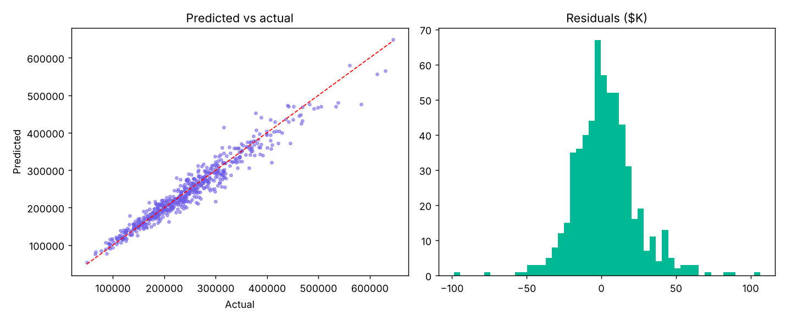
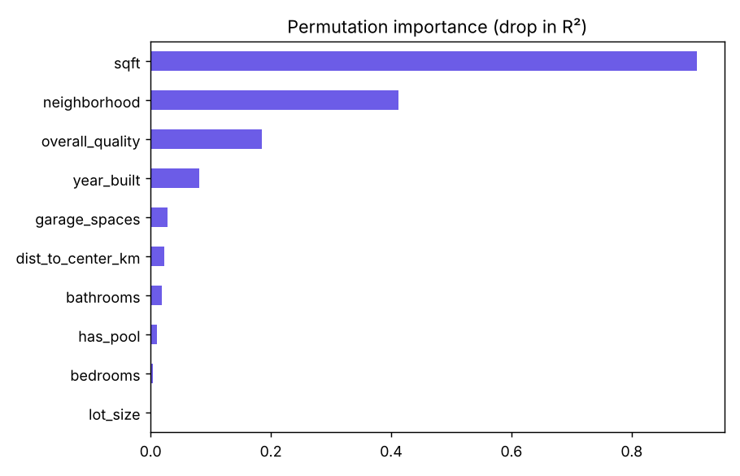

# 🏠 House Price Predictor

End-to-end machine learning project: **EDA → feature engineering → model comparison → tuned model → Flask web app + JSON API**.



## Highlights
- **Test R² = 0.9468**, MAE = **$15,407**, MAPE = **6.41%** (tuned Gradient Boosting)
- Leak-free scikit-learn `Pipeline` (imputation, scaling, one-hot, engineered features) wrapped with a log-target transform
- Compared 3 models with 5-fold CV, then tuned the winner with `GridSearchCV`
- Deployed as a Flask app (form UI + `/predict` API), Dockerfile and unit tests included

## Project structure
```
house-price-predictor/
├── data/raw/housing.csv          # 3,000-row dataset (generated, reproducible)
├── notebooks/01_eda_and_modeling.ipynb
├── src/
│   ├── generate_data.py          # synthetic data generator (swap in real CSV anytime)
│   ├── features.py               # preprocessing + feature engineering
│   ├── eda.py                    # EDA figures + summary
│   └── train.py                  # CV, tuning, evaluation, model export
├── app/app.py, templates/index.html   # Flask deployment
├── models/house_price_model.joblib
├── reports/                      # metrics.json + figures
├── tests/test_app.py             # API tests (pytest)
├── docs/index.html               # project showcase page (GitHub Pages)
├── Dockerfile, requirements.txt, push_to_github.sh
```

## Quick start
```bash
python -m venv .venv && source .venv/bin/activate   # Windows: .venv\Scripts\activate
pip install -r requirements.txt

cd src
python generate_data.py   # creates data/raw/housing.csv
python eda.py             # figures -> reports/figures
python train.py           # trains, tunes, saves models/house_price_model.joblib
cd ..

python app/app.py         # open http://localhost:5000
pytest -q                 # run tests
```

## Methodology
1. **Data & cleaning** — 3,000 homes, 10 raw features; 2–4% missing values in `lot_size`, `year_built`, `dist_to_center_km` handled by median imputation inside the pipeline (no leakage).
2. **EDA** — price is right-skewed (skew ≈ 0.97) so the target is modeled as `log1p(price)`; `sqft` and neighborhood dominate price; quality and age add signal after controlling for size.
3. **Feature engineering** — `house_age`, `sqft_per_bedroom`, `bath_bed_ratio`.
4. **Modeling** — Ridge baseline, Random Forest, Gradient Boosting; 80/20 split, 5-fold CV on train.
5. **Tuning** — grid over `n_estimators`, `learning_rate`, `max_depth` → best: `{'learning_rate': 0.05, 'max_depth': 3, 'n_estimators': 400}`.
6. **Interpretation** — permutation importance on raw features (top: sqft, neighborhood, overall_quality).

## Results (hold-out test set, 600 homes)
| Model | R² | MAE | RMSE | MAPE |
|---|---|---|---|---|
| Ridge (baseline) | 0.9176 | $18,668 | $26,441 | 7.85% |
| Random Forest | 0.9043 | $21,429 | $28,494 | 9.1% |
| Gradient Boosting | 0.9389 | $16,782 | $22,754 | 7.08% |
| Gradient Boosting (tuned) | 0.9468 | $15,407 | $21,240 | 6.41% |



## Usage guide (API)
```bash
curl -X POST http://localhost:5000/predict -H "Content-Type: application/json" -d '{
  "sqft": 1800, "bedrooms": 3, "bathrooms": 2, "year_built": 2005, "lot_size": 5500,
  "garage_spaces": 2, "overall_quality": 7, "has_pool": 0, "dist_to_center_km": 6,
  "neighborhood": "Oakwood"}'
```
Response: `{"predicted_price": 395200, "formatted": "$395,200", "range_low": ..., "range_high": ...}`

| Endpoint | Method | Purpose |
|---|---|---|
| `/` | GET | Web form |
| `/predict` | POST | JSON prediction (400 on invalid input) |
| `/health` | GET | Liveness check |

**Docker:** `docker build -t hpp . && docker run -p 5000:5000 hpp`

## Limitations & next steps
- Data is synthetic; swap in a real dataset (e.g. Ames, Kaggle) with the same columns for real-world claims.
- Range shown is a fixed ±7% (≈ test MAPE), not a true prediction interval → add quantile regression / conformal intervals.
- Add SHAP explanations, MLflow tracking, CI (GitHub Actions), and cloud deploy (Render / Railway).

## Publish to GitHub
```bash
./push_to_github.sh https://github.com/<your-username>/house-price-predictor.git
```
Then enable **Settings → Pages → main / docs** for the showcase page.

## License
MIT
